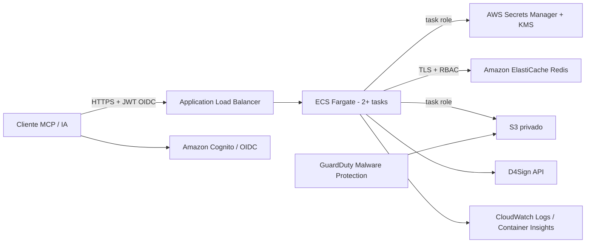

# Operação e implantação na AWS

## Desenvolvimento local

1. Instale Node.js 20+ e execute `npm ci`.
2. Copie `.env.example` para `.env`.
3. Mantenha `NODE_ENV=development`, `MCP_AUTH_MODE=static`, `D4SIGN_CREDENTIAL_BACKEND=environment`, `MCP_STATE_BACKEND=memory` e `MCP_UPLOAD_BACKEND=memory`.
4. Informe credenciais D4Sign de sandbox e a cota real da conta.
5. Para HTTP, gere `MCP_BEARER_TOKEN` e `MCP_REQUEST_STATE_KEY` independentes com pelo menos 32 bytes. O stdio não precisa de bearer.
6. Execute `npm run build` e inicie stdio ou HTTP.

Nenhum `.env`, token, chave ou fixture real deve entrar no Git, na imagem ou nos logs.

## Topologia AWS



- ALB encerra TLS com certificado ACM.
- Cognito emite access tokens vinculados a este recurso pelo client ID autorizado (o access token do Cognito não tem `aud`); uma Lambda V2 restringe os scopes conforme grupos.
- WAF regional com regra rate-based e listas gerenciadas AWS na frente do ALB; access logs do ALB em bucket próprio.
- Secrets Manager contém um secret por principal/tenant para as credenciais D4Sign.
- ElastiCache compartilha cache, cota, rate limit, replay MRTR, claims de upload e gerações de invalidação entre tasks; a ACL restringe prefixo e somente os comandos usados pela aplicação, e `maxmemory-policy=noeviction` evita que pressão de memória descarte silenciosamente anti-replay ou cota.
- S3 guarda uploads temporários com SSE-KMS, versionamento e lifecycle de um dia; o consumo do handle apaga a versão específica do objeto.
- GuardDuty marca resultados com `GuardDutyMalwareScanStatus`; leitura é negada antes de `NO_THREATS_FOUND`.
- ECS task role fornece credenciais AWS temporárias; não existem access keys no container.

## Pré-requisitos

- uma conta/região AWS com GuardDuty Malware Protection for S3 disponível;
- VPC com ao menos duas subnets públicas e duas privadas em AZs distintas;
- NAT Gateway ou VPC endpoints necessários para ECR, CloudWatch, Secrets Manager, S3 e saída HTTPS para a D4Sign;
- repositório ECR e imagem publicada;
- certificado ACM validado para o domínio final;
- callback URLs exatas dos clientes MCP;
- permissões para CloudFormation criar IAM, Cognito, ECS, ALB, ElastiCache, KMS, S3 e GuardDuty.

## Provisionamento

`infra/main.yaml` cria KMS, secrets operacionais, S3, GuardDuty, Cognito, ElastiCache, ALB, ECS Fargate, autoscaling, CloudWatch e IAM de execução/aplicação.

Exemplo:

```bash
aws cloudformation deploy \
  --region us-east-1 \
  --stack-name d4sign-mcp-prod \
  --template-file infra/main.yaml \
  --capabilities CAPABILITY_IAM \
  --parameter-overrides \
    NamePrefix=d4sign-mcp \
    ImageUri=111122223333.dkr.ecr.us-east-1.amazonaws.com/d4sign-mcp@sha256:DIGEST \
    PublicBaseUrl=https://mcp.exemplo.com \
    AllowedHosts=mcp.exemplo.com \
    AllowedOrigins=https://app.exemplo.com \
    VpcId=vpc-EXEMPLO \
    PublicSubnetIds=subnet-public-a,subnet-public-b \
    PrivateSubnetIds=subnet-private-a,subnet-private-b \
    CertificateArn=arn:aws:acm:us-east-1:111122223333:certificate/EXEMPLO \
    CognitoDomainPrefix=d4sign-mcp-prod-exemplo \
    OAuthCallbackUrls=https://cliente.exemplo.com/oauth/callback \
    AlarmEmail=plantao@exemplo.com
```

Parâmetros opcionais relevantes: `AlarmEmail` assina o tópico SNS dos alarmes (vazio cria o tópico sem assinatura) e `WafRateLimitPerFiveMinutes` ajusta a regra rate-based do WAF.

Depois do deploy:

1. crie o alias DNS no Route 53 apontando para `LoadBalancerDnsName`;
2. confirme que `PublicBaseUrl` resolve para o ALB e que o certificado está correto;
3. confirme a assinatura do e-mail no tópico `AlarmTopicArn` (o SNS envia confirmação);
4. crie ou conecte os usuários, habilite MFA e atribua cada um a um dos grupos provisionados;
5. teste a metadata OAuth e faça uma chamada autenticada de ponta a ponta;
6. confirme no token emitido que `client_id` é o valor de `CognitoAllowedClientId` e que `token_use` é `access`.

## Liberação da metadata para ferramentas de IA

`OIDC_METADATA_FACADE` vem **desligada por padrão**, então publicar a imagem nova não altera o comportamento. A ordem segura:

1. Publicar a imagem e atualizar o serviço. Nada muda para quem já usa.
2. Rodar `node scripts/verify-mcp-oauth-metadata.mjs https://<dominio>` e anotar as duas falhas esperadas (PKCE e `grant_types_supported`).
3. Nova revisão da task definition com `OIDC_METADATA_FACADE=true`.
4. Rodar o verificador de novo: precisa terminar sem falhas.
5. Conferir que um login existente continua funcionando (`tmp/testar-producao.mjs`).

Reversão: voltar `OIDC_METADATA_FACADE` para `false` e atualizar o serviço. Os tokens já emitidos continuam válidos, porque a emissão nunca saiu do Cognito.

## Usuários e grupos do Cognito

A stack provisiona `d4sign-readers`, `d4sign-operators` e `d4sign-admins`. Usuários sem grupo só recebem `d4sign:credentials:write`, suficiente para cadastrar ou rotacionar a própria conta D4Sign sem acesso às tools. Conceda o menor grupo necessário:

```bash
USER_POOL_ID="$(aws cloudformation describe-stacks \
  --stack-name d4sign-mcp-prod \
  --query "Stacks[0].Outputs[?OutputKey=='CognitoUserPoolId'].OutputValue" \
  --output text)"

aws cognito-idp admin-add-user-to-group \
  --user-pool-id "$USER_POOL_ID" \
  --username usuario@exemplo.com \
  --group-name d4sign-readers
```

Trocar de perfil exige remover o grupo anterior com `admin-remove-user-from-group`. Evite múltiplos grupos; se existirem, a política aplica a permissão mais alta entre eles. Tokens já emitidos permanecem válidos até expirar ou serem revogados; novos tokens são recalculados pela Lambda Pre Token Generation V2.

## Cadastro do usuário final

Depois de autenticar e obter `d4sign-mcp/d4sign:credentials:write`, o usuário faz onboarding fora do chat:

```bash
curl -X PUT https://mcp.exemplo.com/credentials/d4sign \
  -H "Authorization: Bearer $OIDC_ACCESS_TOKEN" \
  -H 'Content-Type: application/json' \
  --data '{
    "tokenApi": "TOKEN_D4SIGN",
    "cryptKey": "CRYPT_KEY_SE_USADA",
    "environment": "production",
    "requestsPerHour": 1000
  }'
```

Resposta esperada: `204 No Content`. Rotação repete o `PUT`; revogação usa `DELETE`. O segredo nunca volta na resposta. O padrão `principal` mantém uma conta D4Sign por usuário; `tenant` compartilha uma conta por organização.

## CI/CD

- `.github/workflows/ci.yml`: lockfile, typecheck, lint, testes, build, audit, `cfn-lint` e Docker.
- `.github/workflows/deploy-aws.yml`: repete typecheck/lint/testes/`cfn-lint`, assume uma role AWS por GitHub OIDC, publica no ECR, resolve o digest imutável, atualiza a stack CloudFormation e roda smoke test contra a URL pública (readiness, metadata OAuth e 401 em `/mcp` sem token).
- ambientes GitHub `staging` e `production` devem exigir aprovação.
- configure como variables: `AWS_DEPLOY_ROLE_ARN`, `AWS_REGION`, `AWS_STACK_NAME`, `AWS_NAME_PREFIX`, `AWS_ECR_REPOSITORY`, VPC/subnets, ACM, URL/hosts/origins, domínio Cognito, callbacks e `MCP_ALARM_EMAIL`.
- credenciais D4Sign nunca pertencem ao GitHub Actions.

## Observabilidade

Logs JSON registram `requestId`, método, rota, tool, status, duração, tentativa upstream e eventos de mutação. O sanitizer remove bearer, JWT, `tokenAPI`, `cryptKey`, senhas, bytes e base64.

A stack habilita CloudWatch Logs, Container Insights, access logs do ALB e alarmes com destino SNS para: 5xx, targets não saudáveis, volume de 4xx (401/403/429), latência p95, memória e eviction do ElastiCache, e `FailedScanCount`/`InfectedScanCount` do GuardDuty. O alarme de eviction merece atenção especial: eviction no ElastiCache indicaria risco de replay de confirmação MRTR e de bypass de cota.

Eventos de auditoria a monitorar nos logs: `d4sign_mutation`, `d4sign_file_operation`, `d4sign_document_download`, `d4sign_credentials_rotated`, `d4sign_credentials_revoked` e `d4sign_cache_invalidation` com `outcome: failed`.

## Upload e antimalware

O S3 é privado, criptografado por KMS e protegido por lifecycle. O handle pode ser criado imediatamente, mas seu consumo retorna `UPLOAD_SCAN_PENDING` até a tag do GuardDuty ser `NO_THREATS_FOUND`. `THREATS_FOUND`, `UNSUPPORTED`, `ACCESS_DENIED` e `FAILED` são rejeitados, e a versão do objeto é apagada.

A bucket policy nega `GetObject` de objetos ainda não limpos, exceto para a role do scanner. Como `HeadObject` é autorizado como `s3:GetObject`, o servidor consulta a tag por `GetObjectTagging` **antes** de qualquer leitura do objeto: essa ordem é o que faz a janela normal de análise devolver `UPLOAD_SCAN_PENDING` retentável em vez de um `AccessDenied` opaco. Um 403 nessa fase também é mapeado para o mesmo erro transitório. Valide o plano com o arquivo EICAR oficial em ambiente isolado e monitore falhas/skips antes de aceitar documentos reais.

## Health, escala e rollback

- `/health/live`: processo responsivo, sem tocar dependência.
- `/health/ready`: verifica **o estado corrente** das dependências. O ElastiCache é bloqueante — sem ele não há cache, cota, rate limit nem anti-replay, e a task responde `503 {"status":"degraded"}`. O bucket S3 é informativo: aparece em `checks.uploads` mas não tira a task do balanceador, porque afeta só as quatro tools de upload. Não consome cota D4Sign. É o que permite ao circuit breaker do ECS detectar uma revisão degradada e fazer rollback.
- ALB e ECS usam esses endpoints; as sondas são servidas antes da validação de `Host`, porque chegam com o IP da task.
- autoscaling vai de 2 a 5 tasks por CPU no exemplo.
- ECS deployment circuit breaker faz rollback automático quando uma revisão não estabiliza.
- `SIGINT`/`SIGTERM` iniciam drenagem com prazo (`MCP_SHUTDOWN_GRACE_MS`, padrão 20 s): conexões ociosas caem imediatamente, as ativas têm o prazo para terminar, o restante é fechado à força e só então o Redis é liberado. O `StopTimeout` da task (40 s) é maior que esse prazo de propósito — sem isso, um stream SSE com keep-alive impediria `server.close()` de completar e o SIGKILL derrubaria rodadas de confirmação em voo.

## Checklist de release

```bash
npm ci
npm run typecheck
npm run lint
npm test
npm run build
npm audit --audit-level=moderate
uvx cfn-lint infra/main.yaml
docker build -t d4sign-mcp:local .
```

Depois, validar na conta real:

- chamada autenticada de ponta a ponta e `client_id`/`token_use` do token emitido;
- os quatro perfis de scopes (sem grupo, reader, operator e admin) e que um scope sem prefixo é recusado;
- isolamento entre dois principais distintos em cache, cota, credencial e handle;
- replay de confirmação MRTR entre duas tasks com o mesmo `requestState`;
- rotação e revogação de credencial com 2+ tasks ativas, conferindo a propagação imediata;
- GuardDuty com o arquivo EICAR oficial, incluindo a janela de scan pendente;
- queda e reconexão do ElastiCache, conferindo que `/health/ready` passa a 503;
- consumo concorrente do mesmo `uploadHandle`, conferindo que só um documento é criado;
- leitura no sandbox e mutações somente com fixtures autorizadas.
